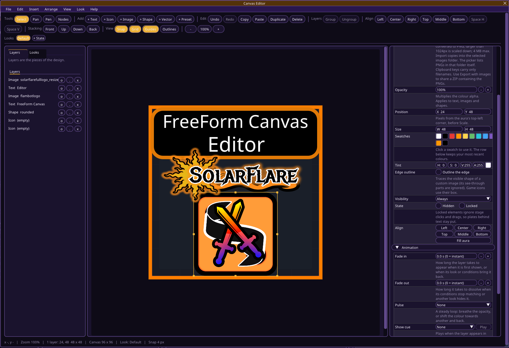
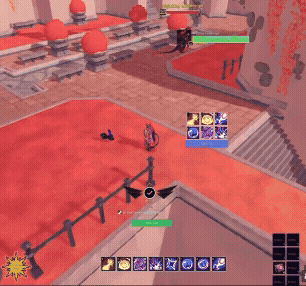

<h1 align="center">SolarFlare</h1>

<p align="center">
  <strong>Custom UI, Auras and Action Bars for Farever.</strong><br>
  The complete customizable HUD, aura alert and combat tracking suite.
</p>

<p align="center">
  <a href="https://github.com/Flambeau-Phoenix/SolarFlare-Beta/releases/latest"></a>
  <a href="https://github.com/Flambeau-Phoenix/SolarFlare-Beta/releases"></a>
  
  
  
</p>

<p align="center">
  <a href="https://github.com/Flambeau-Phoenix/SolarFlare-Beta/releases/latest"><b>Download</b></a> ·
  <a href="https://www.nexusmods.com/farever/mods/12?tab=files">Nexus Mods</a> ·
  <a href="CHANGELOG.md">Changelog</a> ·
  <a href="https://github.com/Flambeau-Phoenix/SolarFlare-Beta/issues">Report a bug</a>
</p>



SolarFlare is a fully customizable interface and combat awareness mod for **Farever**,
built on the [HLX Modding Framework](https://hlx-framework.github.io/) by
[laymain](https://github.com/laymain). It gives you complete control over your HUD:

- **ResourceTracker:** independent, movable widgets for Health, Shields, Rage, Mana/Spark,
  Prayers, Combo Points, Conduits and Target Vitals.
- **Auras:** dynamic visual alerts, procedural glow rings, countdown timers and kill/use
  counters for buffs, procs, cooldowns and boss mechanics.
- **Geaux Grid:** a dedicated skill-monitoring display with radial cooldown sweeps, charge
  indicators, keybind labels and proc glimmer.
- **BarTer:** your own action bars for native skills, consumables and display-only
  statuses, following the weapon you wear.
- **ExtraBars and Spark Cube:** consumable bars with their own keybinds, plus a Spark Cube
  tracker.
- **Status Board:** a movable board of your active statuses.
- **Combat Intelligence:** an in-game **Lightsaber** DPS meter with pet and minion
  attribution, a live **Combat Log** and the **GetRifty** timer.




**Contents:**
[Install](#install) ·
[Quick controls](#quick-controls) ·
[Features](#flagship-features) ·
[Runtime](#eight-hook-runtime) ·
[For developers](#for-developers) ·
[Feedback and support](#feedback-and-support) ·
[Rights and credits](#rights-and-credits)

## Install

> [!IMPORTANT]
> Download SolarFlare **only** from the official sources: this repository's
> [Releases page](https://github.com/Flambeau-Phoenix/SolarFlare-Beta/releases) or the
> [Nexus Mods page](https://www.nexusmods.com/farever/mods/12?tab=files). The mod loads
> native code into the game, so see [SECURITY.md](SECURITY.md) before using copies from
> anywhere else.

**Requirements:** Farever, and the [HLX framework](https://github.com/hlx-framework/hlx-core/releases).
SolarFlare bundles its own tested HLX runtime build with support for HashLink bytecode
versions **2, 3, 4, 5 and 6**. That includes Farever 0.2.4 (HLB v6) while staying
compatible with older community mods. The bundled DLL exposes the HLX 0.0.10 API surface
but is not claimed to be the byte-identical upstream release artifact.

1. Download the latest **SolarFlare Live** zip from the Releases page.
2. Extract it directly into your **`Farever`** game root folder so you end up with:

```text
Farever/
├── libhl64.dll                        <- Updated v6 + MinHook native loader
└── hlx/
    ├── config/
    │   └── loader.conf
    ├── loader/
    │   └── hlx-loader.hl              <- Synchronized loader bytecode (PBBDB_i ABI)
    ├── plugins/
    │   ├── sfimgui/
    │   │   ├── sfimgui.hdll           <- Isolated SolarFlare ImGui plugin
    │   │   └── fonts/                 <- Bundled UI fonts
    │   └── sfcursor/
    │       └── sfcursor.hdll          <- Lightweight Win32 cursor confinement plugin
    └── mods/
        └── solarflare/
            ├── solarflare.hl          <- Mod bytecode
            └── assets/                <- Supplied CDB tables, icons and atlases
```

3. Launch **Farever** and press **F6**.

> [!NOTE]
> **Updating:** replace `solarflare.hl` (and `sfcursor.hdll` if the release includes a new
> one). Your settings, profiles, auras and notebook are kept.

> [!NOTE]
> **Plugin independence:** SolarFlare uses its own `sfimgui.hdll` rather than relying on a
> shared `imgui64.hdll`. If other installed mods require `imgui64.hdll`, leave it in place;
> both plugins coexist without load-order conflicts.

**Removing SolarFlare:** delete `hlx/mods/solarflare`, `hlx/plugins/sfimgui` and
`hlx/plugins/sfcursor`. Your settings live in `hlx/mods/SolarFlare/` (see
[runtime data paths](#runtime-data-paths)); keep that folder if you may reinstall.

## Quick controls

- **F6:** show or hide the SolarFlare Control Hub and builders.
- **Hide All keybind:** instantly toggle every SolarFlare HUD overlay (Numpad by default,
  or Middle Mouse via Resource Tracker settings). The F6 hub stays accessible.
- **Move and resize:** unlock any window in its settings. Drag the **sun icon** to
  reposition, drag the bottom-right corner to resize, and click the sun icon to collapse or
  hide. Re-lock when finished.
- **Collapse the hub:** use **Collapse** to shrink it to a narrow module rail while you work
  in a builder. **Expand hub** brings it back.

## What's new

**v6.3b, Misc QoL:** large images are optimized automatically, the freeform canvas grows to
1024×1024, a new "Skill equipped" aura condition, Status Board buff/debuff split and
real spell names on cast bars. Full notes and every earlier release are in the
[changelog](CHANGELOG.md).

## Flagship features

### 1. ResourceTracker
Build your ideal layout with independently movable, stylable resource and combat displays:

| Tracker | What it displays |
|---|---|
| **Health** | Current and max health, temporary shields and dynamic alert thresholds. |
| **Rage** | Current rage levels with an optional maximum-resource pulse. |
| **Mana / Spark** | Automatically tracks Mana or Spark according to your active hero class. |
| **Prayers** | Readiness monitors for Smite, Life and Shield prayers. |
| **Combo Points** | Rogue combo point tracking (0 to 6) with customized pip shapes. |
| **Attack Combo** | Real-time weapon attack-chain tracking with final-hit feedback. |
| **Chaincast** | Chaincast stack accumulation, readiness triggers and remaining window timers. |
| **Conduits** | Sparkmaster conduit slot monitors and Power stacks (0 to 20). |
| **Current Target** | Target portrait, nameplate, health pool and boss/elite difficulty badges. |

* **Customization:** bar orientations (horizontal/vertical), borders, transparency and pip
  shapes. Test empty, partial, full and alert states in real time with the built-in
  previewers.
* **Getting started:** press **F6** → **Resources** → **Open builder**.

### 2. Auras
Create bespoke visual alerts for any gameplay condition:

* **Trigger sources:** health/shield/resource thresholds, skill cooldown readiness,
  resource affordability, status effects (buffs/debuffs on you or targets), prayers, combo
  stacks, rift states and enemy casts.
* **Counters:** persistent boss, enemy and skill use counters that survive logout.
* **Visual FX:** procedural glow rings, custom icon styling, active timers
  (countdowns/countups) and sound/visual pulses.
* **Quick Start catalog:** a searchable CastleDB database covering skills, statuses and 14
  bosses with pre-configured ability triggers. Creation Home groups starting points into
  Utilities, Skills, Consumables and Blank cards.
* **Getting started:** press **F6** → **Auras** → Enable aura system → **Open builder**.

### 3. Geaux Skill Grid
A personal skill-monitoring grid that keeps critical abilities in your field of view:

* **Layouts:** configurable rows, columns, padding and slot spacing presets.
* **Visual states:** radial cooldown sweeps, text countdowns, charge count digits,
  ready-flashes, proc glimmer and dimmed unavailable states.
* **Ready glow:** border sparks and core pulses that highlight when priority abilities come
  off cooldown.
* **Getting started:** press **F6** → **Geaux** → Show → **Open builder**. Assign abilities
  via the searchable skill catalog. *(Geaux is an observation HUD; clicking slots does not
  cast skills.)*

### 4. BarTer
Your own bars of native skills, consumables and statuses:

* **Native skills** show the key you bound in Options → Hotkeys; activation stays on the
  native binding.
* **Weapon-aware:** layouts are remembered per weapon loadout, and cells for skills the
  worn weapon lacks stay empty.
* **Consumables** use the in-game consumable binding; filter the catalog to items in your
  inventory.
* **Statuses** can be placed as display-only cells.
* **Getting started:** press **F6** → **BarTer** → **Open BarTer editor**.

### 5. ExtraBars, Spark Cube and Status Board
* **ExtraBars:** consumable bars with per-cell keybinds, hold/toggle activation and a
  drag-and-drop item catalog.
* **Spark Cube:** charged/empty state, surge countdown and burst damage readout.
* **Status Board:** a movable status strip with hide-this-status, icon size, columns and
  optional seconds/stacks.

### 6. Combat tracking and utilities
* **Lightsaber DPS meter:** a local combat log parser with real-time damage-per-second
  tracking, breakdown tables and minion damage attribution.
* **Pet and minion attribution:** damage from summons (for example *Eternal Flower Heart*
  bees, *Pocket Hive* and *Silhouette of Almar* imps) is credited to the parent hero.
* **GetRifty:** an integrated in-game rift clock and timer, configured from its hub page.
* **Notebook:** an in-game scratchpad with full search, page duplication and automatic
  persistence.
* **Profiles and themes:** save, duplicate and switch whole-HUD profiles across characters;
  choose curated color schemes or define your own.


## Eight-hook runtime

SolarFlare's default runtime installs only **8 event hooks** (down from 44 in earlier
releases). Continuous values such as health, shields, resources, cooldowns, statuses,
stacks, durations, Combo Points, Chaincast and Conduit state are read through bounded
sampling instead of competing hook paths.

The remaining hooks are reserved for events that cannot be reconstructed reliably from
current state:

1. Skill cast started
2. Skill cast stopped
3. Local skill use for prayer classification
4. Local incoming damage
5. Outgoing damage
6. SolarFlare UI drag start
7. HUD visibility update (keeps the native-UI hide setting applied)
8. Attack combo count change (wake-up for the Attack Combo Tracker)

The earlier six-hook release was tested live with **Priest, Mage, Warrior and Rogue**
across five combat captures with no hook installation failures, dropped events,
SolarFlare exceptions or crashes. Diagnostic hooks are excluded from the normal
`solarflare.hl` release and remain available only in the separate telemetry build.

## For developers

Full source is provided for modders and contributors.

### Repository layout

| Path | What it is |
|---|---|
| `src/solarflare/` | Haxe source of the mod, one folder per system (`aura`, `barter`, `geaux`, `combatlog`, ...) |
| `SolarFlare_HLX_ModSourceFile/` | `compile.hxml` (the build file) and a copy of `src/` |
| `SolarFlare_Mod_Install/` | The ready-to-extract install tree that ships in release zips |
| `assets/`, `sfimgui/`, `sfcursor/`, `solarflare.hl` | Loose copies of the same files that appear inside `SolarFlare_Mod_Install/` |
| `tools/` | Python helpers that extract unit portraits and build the portrait icon atlas (need Pillow) |
| `atlas assets/` | `atlas.py`, a small script that combines your own images into one atlas plus a JSON map (see its README) |
| `SolarFlare_v6.3b.zip` | The latest release archive (stored with Git LFS) |

The loose copies and `SolarFlare_Mod_Install/` are byte-identical. When you change an
asset or rebuild, update both.

### Build from source

`compile.hxml` targets HashLink 1.17.0 and needs these Haxe libraries: `farever-gamelib`,
`hlx-runtime`, `hl-imgui`, `format`, `hscript` and `json2object`. Its paths are relative to
the repository root (`-cp src`, `assets/cdb/*.json`), so run it from there:

```powershell
haxe SolarFlare_HLX_ModSourceFile/compile.hxml
```

This generates `solarflare.hl`. To test, copy it to `Farever/hlx/mods/solarflare/`. Asset
tables (CDB, icons, atlases) are copied by hand after a game patch. The maintainer's
personal deploy script is not part of this repository.

### Runtime data paths

| Kind | Path |
|---|---|
| Settings | `hlx/mods/SolarFlare/solarflare.json` |
| ImGui state | `hlx/mods/SolarFlare/imgui.ini` |
| In-game notebook | `hlx/mods/SolarFlare/notebook.json` |
| Auras | `hlx/mods/SolarFlare/auras/` |
| CastleDB assets | `hlx/mods/solarflare/assets/cdb/` |
| Icons and atlases | `hlx/mods/solarflare/assets/icons/` |
| Lightsaber DPS logs | `hlx/mods/SolarFlare/logs/saber/` |

The UI plugin has its own developer kit: see [sfimgui/SFimgui-devkit](sfimgui/SFimgui-devkit/README.MD).

## Feedback and support

SolarFlare is in active beta. While the core HUD, Auras and Geaux systems are thoroughly
tested, please report anything unexpected.

- **Bugs and requests:** [open an issue](https://github.com/Flambeau-Phoenix/SolarFlare-Beta/issues/new/choose).
  Please include your Farever version, SolarFlare version, class and weapon, and steps to
  reproduce.
- **Security concerns or a suspicious copy of the mod:** see [SECURITY.md](SECURITY.md).
- **Contributing:** see [CONTRIBUTING.md](CONTRIBUTING.md).

## Rights and credits

SolarFlare is an **unofficial** fan-made mod and is not affiliated with or endorsed by the
developers or publisher of Farever. All game names, assets and trademarks belong to their
owners.

Copyright © 2026 Flambeau-Phoenix. All rights reserved unless stated otherwise. SolarFlare
is free to download and use through the official sources above. Please do not re-upload it
or redistribute modified copies without permission. Bundled third-party components keep
their own licenses; see [THIRD_PARTY_NOTICES.md](THIRD_PARTY_NOTICES.md).

Built on the [HLX Modding Framework](https://hlx-framework.github.io/) by
[laymain](https://github.com/laymain).
